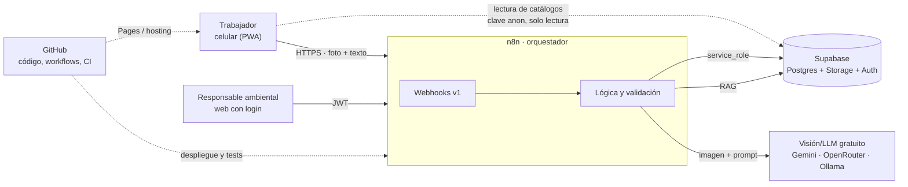
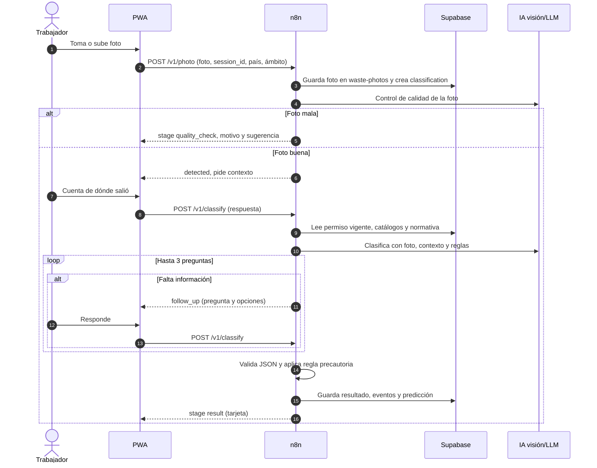
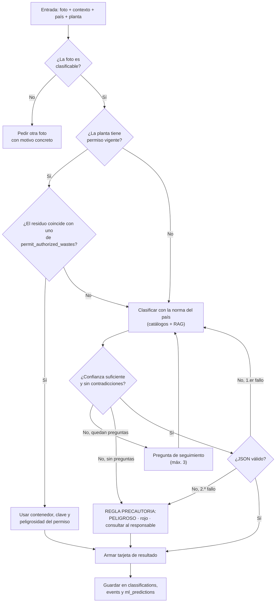
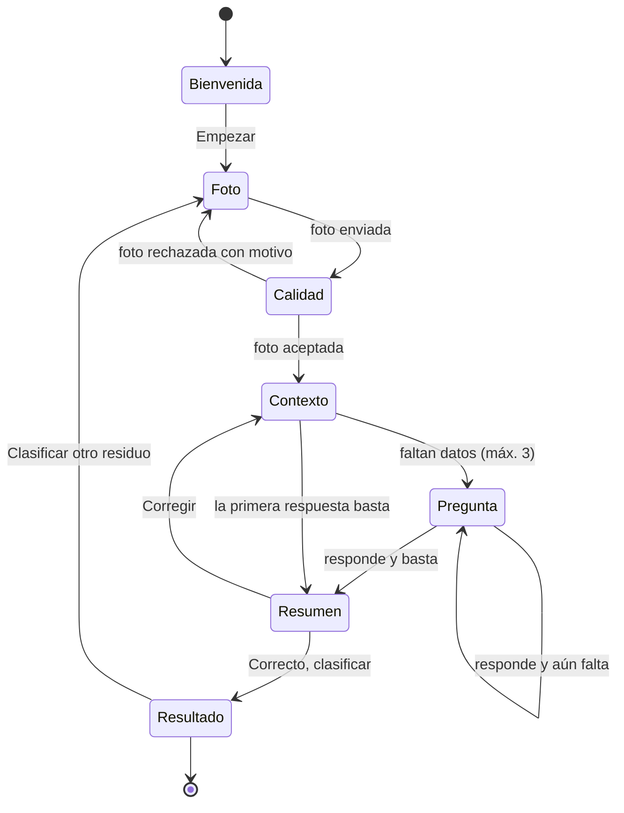
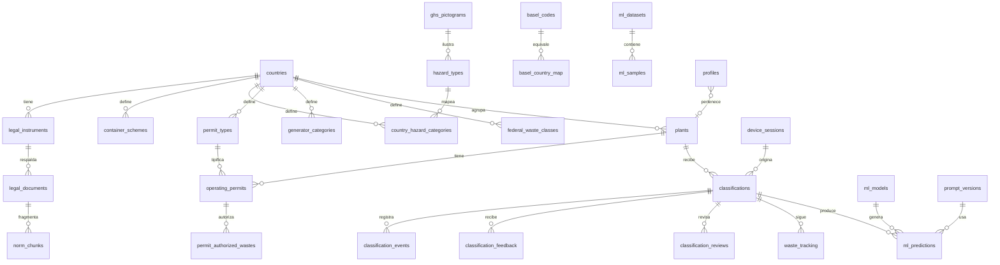
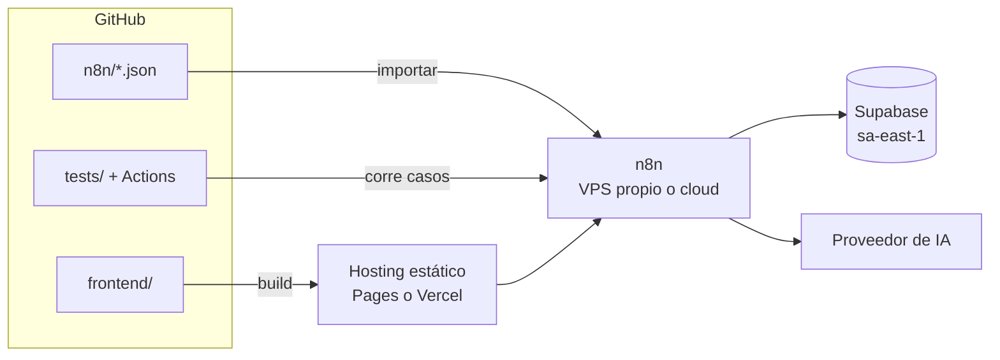

# Tacho Inteligente · Arquitectura del aplicativo

> Los diagramas están en Mermaid y GitHub los dibuja directamente. Todo el trabajo de IA, escritura en la base y reglas pasa por **n8n**; el celular nunca habla con la IA ni con claves.

## 1. Vista general



**Regla de oro:** el cliente solo conoce dos cosas: la URL pública de n8n y la clave `anon` de Supabase (lectura de catálogos). La clave `service_role` y las de IA viven únicamente en las credenciales de n8n.

## 2. Flujo de una clasificación



## 3. Lógica de decisión (dentro de n8n)



Notas de reglas: un envase que contuvo una sustancia peligrosa es peligroso aunque esté vacío; si foto y texto se contradicen, se avisa y se aplica la regla precautoria. En México, si el residuo no está en el permiso, se avisa que no está autorizado.

## 4. Workflows de n8n

| ID | Nombre | Disparador | Qué hace | Tablas |
|---|---|---|---|---|
| WF-01 | `sesion-iniciar` | Webhook POST `/v1/session` | Crea o renueva la sesión anónima | `device_sessions` |
| WF-02 | `foto-calidad` | Webhook POST `/v1/photo` | Sube la foto, evalúa calidad con visión, crea la clasificación | `classifications`, `classification_events`, `ml_predictions`, bucket `waste-photos` |
| WF-03 | `clasificar` | Webhook POST `/v1/classify` | Arma contexto, llama a la IA, valida JSON, decide pregunta o resultado | `classifications`, `container_schemes`, `basel_codes`, `operating_permits`, `permit_authorized_wastes`, `norm_chunks`, `prompt_versions` |
| WF-04 | `feedback` | Webhook POST `/v1/feedback` | Guarda utilidad y comentario | `classification_feedback` |
| WF-05 | `permiso-subir` | Webhook POST `/v1/permits` (con JWT) | Guarda el archivo, extrae número, vigencia y residuos con visión/OCR y los deja en revisión | `operating_permits`, `permit_authorized_wastes`, bucket `permits` |
| WF-06 | `permiso-revisar` | Webhook POST `/v1/permits/{id}/review` | El responsable aprueba o rechaza lo extraído | `operating_permits` |
| WF-07 | `revision-experta` | Webhook / formulario | Jazmín marca la respuesta correcta; alimenta el set de oro | `classification_reviews`, `ml_samples` |
| WF-08 | `normativa-ingestar` | Manual / cron | Descarga PDF, extrae texto, parte en fragmentos, genera embeddings | `legal_documents`, `norm_chunks` |
| WF-09 | `evaluar-modelo` | Manual / GitHub Action | Corre `test_cases` y el set de oro contra un modelo y un prompt | `ml_evaluations`, `ml_predictions` |
| WF-10 | `estadisticas-refrescar` | Cron cada hora | Refresca `mv_daily_stats` | `mv_daily_stats` |
| WF-11 | `permisos-vencimiento` | Cron diario | Marca vencidos y avisa 30 días antes | `operating_permits` |
| WF-99 | `error-global` | Error Trigger | Registra el fallo y avisa | `classification_events` |

**Patrón común de cada webhook de cliente:** validar `X-Client-Key` (hash contra `api_clients`) → validar entrada → ejecutar → responder siempre con la misma forma de error `{ "error": { "code", "message" } }`. Los pasos de IA llevan reintento único y salida de error hacia la regla precautoria.

## 5. Contrato de la API (webhooks de n8n)

| Método y ruta | Entrada | Respuesta |
|---|---|---|
| `POST /v1/session` | `device_hash`, `platform`, `app_version`, `country`, `scope`, `sector?` | `session_id` |
| `POST /v1/photo` | multipart: `photo`, `session_id`, `country`, `scope`, `sector?`, `plant_id?` | `classification_id`, `stage` (`quality_check` o `follow_up`), `quality`, `detected` |
| `POST /v1/classify` | `classification_id`, `answer?` (texto o botón), `confirm?` | `stage` (`follow_up`, `summary` o `result`), `follow_up`, `summary` o `result` |
| `POST /v1/feedback` | `classification_id`, `helpful`, `comment?` | `ok` |
| `POST /v1/permits` | JWT + archivo, `plant_id`, `permit_type` | `permit_id`, residuos extraídos pendientes de revisión |
| `POST /v1/permits/{id}/review` | JWT + decisión | `status` |

Las respuestas de `classify` siguen el JSON de la sección 6 del README. Los catálogos (contenedores, colores, categorías, pictogramas GHS, reglas de manejo) se leen **directo de Supabase** con la clave `anon`, porque son públicos y cacheables.

## 6. Pantallas y estados del cliente



Funciones transversales: selector de país y ámbito, modo sin conexión para catálogos (service worker), reintento de envío con conexión lenta, aviso de privacidad en la pantalla de foto, pie "Demo · datos simulados".

## 7. Modelo de datos (resumen)

El detalle completo, con las relaciones entre Basilea y las normas de cada país, está en [`BASE_DE_DATOS.md`](BASE_DE_DATOS.md).



Grupos: **referencia** (países, normas, contenedores, peligrosidad, Basilea, GHS, reglas de manejo), **permisos** (tipos, categorías, permisos, residuos autorizados), **operación** (sesiones, clasificaciones, eventos, retroalimentación, revisiones, seguimiento), **accesos** (perfiles, clientes API, registros), **ML** (modelos, prompts, datasets, muestras, predicciones, evaluaciones, embeddings) y **estadísticas** (vista materializada y vistas).

## 8. Despliegue



**Aplicativo móvil:**
1. **PWA** instalable desde el navegador: gratis, inmediata, sin tiendas. Es el camino del prototipo.
2. **Google Play:** empaquetar la PWA como TWA con Bubblewrap o PWABuilder. Cuenta de desarrollador con pago único; revisión de pocos días.
3. **App Store:** empaquetar con Capacitor. Requiere Mac con Xcode o servicio en la nube y cuenta anual de desarrollador. Apple pide que la app aporte más que una web envuelta (cámara, notificaciones, uso sin conexión).

## 9. Seguridad y privacidad

- Claves de IA y `service_role` solo en credenciales de n8n; nunca en el repo ni en el cliente.
- RLS en todas las tablas: catálogos públicos de lectura; resto solo vía n8n o por rol y planta.
- Fotos y permisos en buckets privados; el cliente accede con URLs firmadas de corta vida.
- No guardar fotos con personas ni logos; aviso en pantalla.
- Los permisos pueden contener datos de empresas reales: viven solo en la base, nunca en el repo ni en datos de ejemplo.
- Limitar la tasa de peticiones en n8n por `X-Client-Key` y por sesión; registrar accesos en `access_logs`.
- Los datos de normas con `verified = false` se muestran con la etiqueta "Sugerencia de IA · verificar con el responsable ambiental".

## 10. Estructura del repositorio

```
/README.md
/docs/ARQUITECTURA.md
/frontend/        PWA (código exportado de AI Studio)
/n8n/             workflows exportados (sin credenciales)
/prompts/         prompts versionados
/data/            semillas en JSON
/supabase/        migraciones SQL
/tests/           casos de prueba y set de fotos
```

## 11. Siguientes pasos

1. Autorizar el conector de n8n y crear WF-01 a WF-03 (camino mínimo funcional).
2. Cargar el catálogo completo de Basilea y el prompt v1 en la base.
3. Subir el código exportado de AI Studio a `/frontend` y apuntarlo a los webhooks.
4. Armar WF-09 y medir contra el set de oro de Jazmín.
5. Validar con Jazmín las tablas marcadas `verified = false`.
