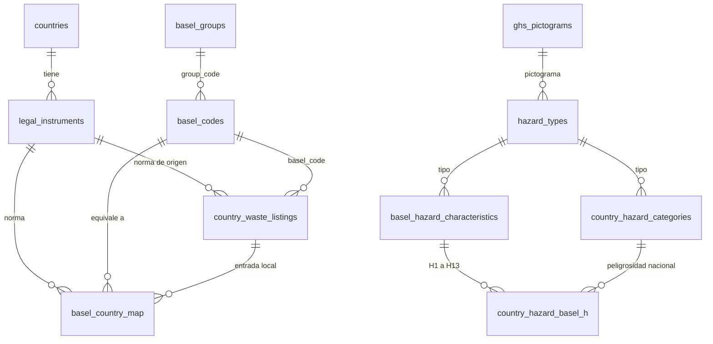

# TachoRojo · Base de datos

Supabase (Postgres 17), proyecto **TachoRojo**, región `sa-east-1`. 43 tablas, 7 vistas, 1 vista materializada y 3 buckets privados.
Para reconstruirla: [`supabase/README.md`](../supabase/README.md). Fuentes y nivel de verificación: [`FUENTES.md`](FUENTES.md). Lo que falta: [`PENDIENTES.md`](PENDIENTES.md).

## 1. Cómo se relacionan Basilea y las normas de cada país



- **`basel_codes`**: catálogo único (174 códigos): categorías Y1–Y49, Lista A (63), Lista B (62). Cada código lleva texto oficial en español e inglés, estado (`vigente` o `derogado`), fechas de vigencia y códigos relacionados.
- **`country_waste_listings`**: las entradas de las normas nacionales (645): México NOM-052 (Listados 1 a 5) y Chile DS 148 (Listas I, II, III y A1129).
- **`basel_country_map`**: une los dos mundos (288 filas), con el tipo de relación:

| `map_type` | Significado | Ejemplo |
|---|---|---|
| `adopta` | El país usa el mismo código de Basilea | Perú: Anexo III y V del D.S. 014-2017; Chile: Lista A y B del DS 148 |
| `exacto` | Misma categoría y mismo orden | Chile: Lista I.n = Y n; Lista II.n = Y (n+18) |
| `parcial` | Equivalente en concepto, no idéntico | México: Listados 3 y 4 = A4140; Chile III.2 = A4130 |
| `inferido` | Reservado para equivalencias sin texto que las respalde | (sin uso por ahora) |

Cada fila trae `confidence` (alta, media, baja) y `basis` (`texto_oficial` o `inferencia`). Todo lo `inferencia` tiene `verified = false` y debe validarlo Jazmín.

- **`country_hazard_basel_h`**: relaciona la peligrosidad nacional (CRETIB en México, DS 148 en Chile, características del D.S. 014-2017 en Perú) con las características H1–H13 de Basilea, y de ahí con el pictograma GHS.

### Consultas útiles

```sql
-- ¿Cómo se llama un código de Basilea en cada país?
select country_code, local_code, map_type, confidence from v_basel_by_country where basel_code = 'A4130';

-- Buscar un residuo mexicano por CAS o por nombre
select entry_key, description, hazard_codes, basel_code from v_listing_basel
where country_code = 'MX' and (cas = '67-64-1' or description % 'acetona');

-- Código de Basilea vigente para lámparas de mercurio: texto oficial más sus códigos relacionados
select code, status, related_codes, description_es from basel_codes
where to_tsvector('spanish', description_es) @@ plainto_tsquery('spanish', 'mercurio');

-- Qué pictograma y qué categorías nacionales corresponden a una característica H
select * from v_country_hazard_basel where h_code = 'H8';
```

## 2. Lo que cambió en Basilea y ya está reflejado

| Cambio | Vigencia | Cómo queda |
|---|---|---|
| Plásticos (BC-14/12): nuevos Y48, A3210, B3011 | 1/1/2021 | B3010 queda `derogado` desde el 31/12/2020 |
| Residuos electrónicos (BC-15/18): nuevos Y49 y A1181 | 1/1/2025 | A1180, B1110 y B4030 quedan `derogado` desde el 31/12/2024 |

Perú y Chile publicaron sus anexos antes de estos cambios, así que **no incluyen** A1181, A3210 ni B3011. La app debe tratarlo: para un residuo electrónico, usar A1181 con aviso de que el país aún cita A1180.

## 3. Rubros: cómo la app afina por actividad

`industry_sectors` define 10 rubros: generación eléctrica, transporte y logística, minería, oficinas, construcción, manufactura, hidrocarburos, salud, agroindustria y comercio. Cada uno trae `prompt_context_es`, un texto corto que n8n agrega al prompt para que la IA espere los residuos típicos del lugar.

`sector_waste_profiles` lista los residuos típicos de cada rubro (115 en total): código de Basilea principal y alternos, tipos de peligrosidad, si suele ser peligroso, frecuencia y una `question_hint_es` con la pregunta que más ayuda a desambiguar. Sirve para dos cosas: darle contexto a la IA y ordenar las opciones de las preguntas de seguimiento.

`plants`, `classifications`, `test_cases` y `ml_samples` tienen `sector_id`, así que las estadísticas y la concordancia con Jazmín se pueden medir por rubro (`v_sector_classifications`).

Los perfiles son un borrador de Claude (`basis = inferencia`, `verified = false`): los códigos de Basilea salen del catálogo oficial, pero la asignación a cada rubro debe validarla Jazmín.

## 4. Mapa de tablas

| Grupo | Tablas | Filas hoy |
|---|---|---|
| Países y normas | `countries` 3 · `legal_instruments` 15 | |
| Contenedores y reglas | `container_schemes` 29 · `handling_rules` 11 | |
| Peligrosidad | `ghs_pictograms` 9 · `hazard_types` 12 · `country_hazard_categories` 22 · `country_hazard_basel_h` 40 · `basel_hazard_characteristics` 14 | |
| Basilea | `basel_codes` 174 · `basel_groups` 11 · `basel_disposal_operations` 28 · `basel_annex_notes` 8 | |
| Listados y equivalencias | `country_waste_listings` 645 · `basel_country_map` 288 | |
| Permisos (México) | `federal_waste_classes` 3 · `generator_categories` 3 · `permit_types` 3 · `operating_permits` · `permit_authorized_wastes` | |
| Operación | `plants` · `plant_container_overrides` · `device_sessions` · `classifications` · `classification_events` · `classification_feedback` · `classification_reviews` · `waste_tracking` · `test_cases` 8 | |
| Accesos | `profiles` · `api_clients` · `access_logs` | |
| Machine learning | `ml_models` · `prompt_versions` · `ml_datasets` · `ml_samples` · `ml_predictions` · `ml_evaluations` · `image_embeddings` | |
| RAG | `legal_documents` · `norm_chunks` | |
| Rubros | `industry_sectors` 10 · `sector_waste_profiles` 115 | |
| Estadísticas | `mv_daily_stats` · `v_review_agreement` · `v_top_basel` · `v_funnel` · `v_sector_classifications` | |
| Consulta para la app | `v_basel_by_country` · `v_listing_basel` · `v_country_hazard_basel` | |

Las tablas de operación, accesos y ML están vacías a propósito: se llenan cuando la app funcione.

## 5. Índices

- Toda clave foránea tiene su índice (el asesor de Supabase no marca ninguna sin índice).
- Búsqueda de texto: índices GIN con `pg_trgm` sobre `basel_codes.description_es/en` y `country_waste_listings.description`, y búsqueda de texto completo en español sobre `basel_codes`.
- Arreglos: GIN sobre `basel_codes.related_codes` y `country_waste_listings.hazard_codes`.
- Búsqueda por CAS, por clave de entrada, por (país, código local) y por (país, tipo de relación).
- Vectores: `hnsw` con distancia coseno en `norm_chunks` e `image_embeddings`.
- El asesor muestra avisos de "índice sin usar": es normal, la base aún no recibe consultas. No se borró ninguno.

## 6. Seguridad

- RLS activo en todas las tablas. Los catálogos (normas, Basilea, listados, contenedores) se leen con la clave pública.
- Operación y permisos: cada usuario ve solo su planta, según su rol (`operario`, `responsable_ambiental`, `revisor`, `admin`).
- ML, accesos y documentos: solo `admin`. Cinco tablas no tienen políticas a propósito (solo las toca n8n con `service_role`): `device_sessions`, `classification_events`, `classification_feedback`, `image_embeddings`, `plant_container_overrides`.
- Las vistas usan `security_invoker`, y `mv_daily_stats` no es legible desde el cliente.
